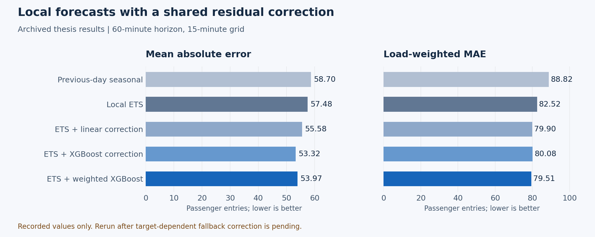

# Forecasting with Short Histories

[](https://github.com/jeck5iv/highload-context-ensemble-forecasting/actions/workflows/checks.yml)

**[Research note](docs/research.md) · [Reproducibility](docs/reproducibility.md) · [Data contract](docs/data_contract.md) · [Русский](README_RU.md)**

**Local statistical models + pooled residual learning for multi-series demand forecasting.**

My bachelor's thesis at HSE University studied how to predict busy periods when many related series are available but each has very little history. I built the forecasting study, compared statistical and machine-learning approaches, and analysed errors across stations and load regimes.

| Data scale | Temporal evidence | Forecasting task |
| --- | --- | --- |
| Approximately 50M entry events, 260 metro stations | One week: 10-16 March 2025 | Eight horizon/grid settings, from 15 minutes to 6 hours |

The research question is about **pooling information under limited temporal coverage**. Millions of events provide many station-level observations, but do not create additional weeks or independent seasonal cycles.

## Method

A separate ETS model captures each station's local profile. A shared XGBoost model learns a correction from pre-test residuals and contextual features:

$$
\widehat y_{s,t+h}=\widehat y^{\mathrm{ETS}}_{s,t+h}+g_\theta(x_{s,t}).
$$

The correction uses forecast disagreement, lags, rolling variability, cyclical time features, previous-day demand and training-period station summaries. Load weighting emphasises busy intervals; residual clipping uses quantiles estimated before the test day.

Comparisons include seasonal baselines, local ETS/SARIMA, global boosting, LSTM/Transformer models, fixed blends and context-dependent ensembles. Larger models did not consistently outperform local ETS in this short-history setting. The [research note](docs/research.md) retains these comparisons and distinguishes article-inspired adaptations from exact reproductions.

## Recorded thesis results

For a 60-minute horizon on a 15-minute grid, the saved load-weighted residual model improves recorded LW-MAE from **82.52 to 79.51** and MAE from **57.48 to 53.97**.

**Evidence status:** these are archived aggregate results, not a fresh training run. A later audit removed target-dependent fallback paths. The aggregate fixtures cannot establish whether those paths affected the recorded scores; rerunning the corrected code on the private data is required before treating the gains as verified.



The recorded station-bootstrap 95% interval for the 3.01-point LW-MAE difference is [1.93, 4.07]. It describes variation across this station panel, not generalisation to new weeks or uncertainty from model selection. Full values are in the [central fixture](tests/fixtures/h060m_b015m/micro_metrics.csv).

## Validation design

- Train local models on Monday-Tuesday, use Wednesday for model selection and residual fitting, and evaluate the central comparison on Thursday.
- Define operational days as 03:00-02:59 and clip target windows at split boundaries.
- Report ordinary, load-weighted and high-load errors, including underprediction diagnostics.
- Resample stations after predictions are fixed; retain separate results by forecast horizon and aggregation grid.

Friday and the weekend are outside the central comparison. A frozen test on additional weeks is the next step for assessing robustness.

## Run public checks

Python 3.11 or 3.12. These commands need neither private passenger records nor a GPU:

```bash
python -m venv .venv
source .venv/bin/activate
python -m pip install -e '.[dev]'
pytest
python scripts/summarize_results.py
python scripts/plot_recorded_results.py
```

The last two commands read saved aggregate results; they do not retrain models. Tests cover temporal boundaries, bootstrap behaviour and regression fixtures.

## Run a forecasting experiment

With authorised data matching the [data contract](docs/data_contract.md):

```bash
python -m pip install -e '.[full]'
python scripts/run_metro_forecasting.py \
  --data-dir ./data \
  --cache-dir ./data/cache \
  --output-dir ./outputs/metro_short_history_h060_b015 \
  --n-bootstrap 1000
```

The seed is 3228. The [reproducibility guide](docs/reproducibility.md) covers smaller runs, horizon sweeps and result comparisons; the [output contract](docs/prediction_artifacts.md) describes generated artifacts.

## Code map

| Path | Responsibility |
| --- | --- |
| [Study entry point](src/metroflow/studies/metro_short_history_forecasting/entrypoint.py) | Experiment configuration, runner and output writer |
| [Models](src/metroflow/studies/metro_short_history_forecasting/models/) | Local, global and residual methods |
| [Data layer](src/metroflow/studies/metro_short_history_forecasting/data_layer/) | Aggregation, station mapping and supervised windows |
| [Evaluation](src/metroflow/studies/metro_short_history_forecasting/evaluation/) | Metrics and station bootstrap |
| [Configurations](configs/) | Reusable experiment settings |

The earlier [single-station notebook](https://github.com/jeck5iv/Kalinin_Diplom_AMI) is an exploratory predecessor. Raw passenger records and trained artifacts derived from them are excluded from this repository.
